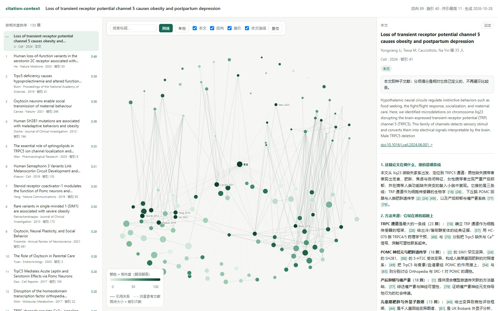

# Citation Context

**把一篇论文变成一张可核验的引用地图。**

给一个 DOI 或 arXiv ID，它会抓取后向参考文献与前向施引文献，打分、分簇，写出四段式叙述，
并渲染成一个离线可开的 HTML 报告：引用图 + 按相关度排序的清单 + 每篇详情。

[English](README.md) · [Skill 文档](skills/citation-context/SKILL.zh.md) · [数据结构](skills/citation-context/references/schema.md)



## 与现有工具的区别

- **可核验**：叙述里每个 `[n]` 都对应真实节点；`lint` 会拦下未知编号、编造数字、漏写的簇、搞反的引用方向。
- **离线**：报告是单个 HTML，无 CDN、无字体、无网络请求，可邮件转发、可归档。
- **分工清楚**：取数、去重、打分、分簇、渲染都是 Python；只有叙述由模型写。
- **不掩盖数据缺口**：缺摘要、参考文献被截断、采样口径、限流，都会写进 `pack.caveats`。

## 安装

```bash
npx skills add <owner>/citation-context --skill citation-context
# 或把 skills/citation-context/ 复制到你的 agent 的 skills 目录
```

需要 Python ≥ 3.9（只用标准库）和访问 OpenAlex / Semantic Scholar 的网络。

## 快速开始

```bash
cd skills/citation-context
python scripts/citegraph.py doctor
python scripts/citegraph.py resolve "10.1364/prj.401755"
python scripts/citegraph.py graph   --run runs/10-1364-prj-401755
python scripts/citegraph.py score   --run runs/10-1364-prj-401755
python scripts/citegraph.py cluster --run runs/10-1364-prj-401755
python scripts/citegraph.py pack    --run runs/10-1364-prj-401755
# 写 runs/10-1364-prj-401755/narrative.md，然后：
python scripts/citegraph.py lint   --run runs/10-1364-prj-401755
python scripts/citegraph.py layout --run runs/10-1364-prj-401755
python scripts/citegraph.py render --run runs/10-1364-prj-401755
```

也可以直接对 agent 说：“帮我理一下 10.1364/prj.401755 的引用脉络。”

## 产物

| 文件 | 用途 |
|---|---|
| `report.html` | 交互图 + 清单 + 详情 + 叙述 |
| `graph.json` | 引用图与六项得分、证据 |
| `pack.json` | 叙述唯一可用的输入 |
| `lint.json` | 校验结果 |
| `scores.csv` / `graph.graphml` | Excel / Gephi |

## 成本

OpenAlex 数据免费，只按调用计费：单条 DOI 查询免费，列表调用 $0.10/千次。
一篇论文约 **$0.0003–0.0006**、3–6 次请求。无 key 时共享 $0.10/天；免费 key 为 $1/天。
`--free-mode` 用速度换零成本（2–4 分钟）。

## 隐私

key 放 `~/.config/citation-context/config.json` 或环境变量，不会进 skill 目录；
错误 URL 会脱敏；`export-dist` 会扫描 key、邮箱、本机路径，发现即返回退出码 4。

详见 [security.md](skills/citation-context/references/security.md)。

## 限制

- 不支持中文库（CNKI/万方无公开 API）；
- 部分出版商不提供摘要，文本相似度会退化为标题；
- 太新的论文前向引用很少，报告会明说而不是硬编“影响”；
- 标签是启发式的，第 2 段靠分簇而不是标签。

## 许可证

MIT。
